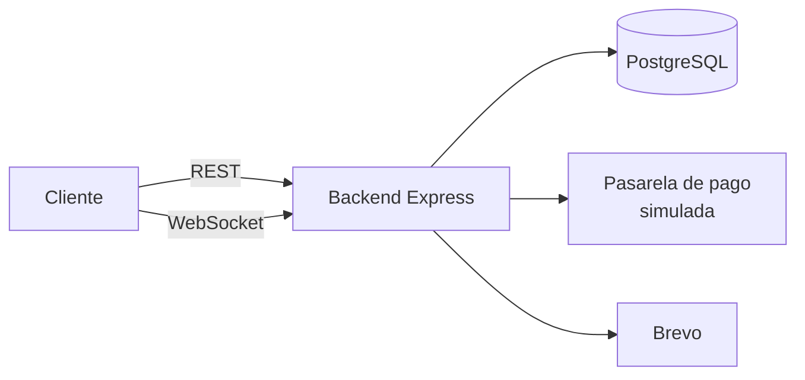

# Lifex — Sistema de Reservas de Vuelos en Tiempo Real

Prototipo de un sistema de reservas de vuelos en tiempo real para la aerolínea ficticia **Lifex**: búsqueda
de vuelos, mapa de asientos interactivo con bloqueo temporal, confirmación de compra con pago simulado y
dashboard de ocupación en vivo.

## Demo en producción

Desplegado en Railway: **<https://fortunate-charm-production.up.railway.app/>**

| Qué | URL |
|---|---|
| Web pública (búsqueda, asientos, compra) | <https://fortunate-charm-production.up.railway.app/> |
| Dashboard de administración (login) | <https://fortunate-charm-production.up.railway.app/dashboard/login> |

Tarjetas de prueba para pagar: `4242 4242 4242 4242` (aprobada), `4000 0000 0000 0002` (rechazada) y
`4000 0000 0000 9995` (timeout de la pasarela). La guía de despliegue está en
[`docs/deploy-railway.md`](docs/deploy-railway.md).

## Visión general de la arquitectura

Monolito modular en Node.js/TypeScript con arquitectura hexagonal (puertos y adaptadores): el dominio
(reglas de negocio) está aislado de la base de datos, del servidor HTTP, del WebSocket y de cualquier
proveedor externo (pago, correo) detrás de interfaces (*puertos*). Cada integración externa es un adaptador
intercambiable, verificado automáticamente por un test de arquitectura que falla si algún módulo importa la
capa equivocada.



El detalle completo — diagrama extendido, justificación de cada decisión, manejo de concurrencia e
idempotencia, y el diagrama de cómo se vería esto en producción a escala de miles de usuarios — está en
[`docs/architecture.md`](docs/architecture.md).

Los criterios de aceptación de cada historia de usuario están en
[`docs/user-stories-acceptance-criteria.md`](docs/user-stories-acceptance-criteria.md); el desglose de
tareas de implementación, en [`docs/tasks.md`](docs/tasks.md); el plan de datos de prueba (seed), en
[`docs/seed-plan.md`](docs/seed-plan.md); el despliegue en Railway, en [`docs/deploy-railway.md`](docs/deploy-railway.md); y el uso de IA durante el desarrollo, en [`docs/ia.md`](docs/ia.md).

## Estructura del repositorio

```
lifex/
├── backend/              # API — Express, arquitectura hexagonal por módulos
│   └── src/shared/notifications/templates/   # plantillas de correo (HTML + texto plano)
├── frontend/
│   ├── web/              # Vite + React — web pública (se publica en "/")
│   ├── dashboard/        # Vite + React + shadcn — login y panel administrativo (se publica en "/dashboard")
│   ├── public/           # activos compartidos: fuentes, fotos de destinos, logos y PNG de correo
│   ├── scripts/          # assemble.mjs: junta los dos builds en frontend/dist
│   └── server.mjs        # servidor estático de producción (web en "/", dashboard en "/dashboard")
├── shared/               # @lifex/shared — esquemas Zod de DTOs y catálogo de eventos de WebSocket
├── docs/
│   ├── architecture.md
│   ├── user-stories-acceptance-criteria.md
│   ├── tasks.md
│   ├── seed-plan.md
│   ├── deploy-railway.md
│   └── ia.md
└── README.md
```

## Ejecución local

> El backend está implementado y probado; el frontend está pendiente.

### Requisitos
- Node.js (versión del `.nvmrc`/`engines` del backend)
- Docker (para PostgreSQL vía Testcontainers en las pruebas de integración, o para levantar Postgres local)
- Una cuenta de Brevo con API key (opcional — sin ella, el envío de correo queda en modo log)

### Shared

```bash
cd shared
npm install      # el backend lo usa en sus pruebas de contrato (y el frontend, con un alias)
npm run typecheck
```

### Backend

```bash
cd backend
cp .env.example .env        # completar JWT_ACCESS_SECRET (≥ 32 caracteres) y, opcional, BREVO_API_KEY
docker compose up -d --wait postgres   # PostgreSQL en 127.0.0.1:55432, base "lifex"
npm install
npm run db:migrate
npm run db:generate
SEED_PASSWORD="<clave de 12+ caracteres>" npm run db:seed   # catálogo, roles, usuarios y vuelos (ver "Seed")
npm run admin:create        # usuario SUPER_ADMIN inicial, si hace falta
npm run dev                 # API en http://localhost:3000 y WebSocket en ws://localhost:3000/ws
```

Usuarios del seed: `admin@lifex.test` (rol `ADMIN`) y `viewer@lifex.test` (rol `ADMIN_VIEWER`), con la clave que
pases en `SEED_PASSWORD` (no hay una por defecto).
Tarjetas de prueba: `4242 4242 4242 4242` (aprobada), `4000 0000 0000 0002` (rechazada),
`4000 0000 0000 9995` (timeout de la pasarela).

### Seed

El seed carga el catálogo (países, ciudades, aeropuertos, aeronaves y tipos de equipaje), los roles, los usuarios
`ADMIN` y `ADMIN_VIEWER` y los vuelos de **hoy a 2027-01-31**: 3 vuelos diarios por cada una de las 90 rutas
nacionales y 2 por cada una de las 38 internacionales (Medellín y Bogotá a 19 destinos). Son unos 25.500 vuelos y
4,4 millones de asientos (~0,93 GB, ~2 minutos). Es idempotente: se puede repetir sin duplicar vuelos.

```bash
# desarrollo (backend/)
SEED_PASSWORD="<clave>" npm run db:seed                       # todo
SEED_PASSWORD="<clave>" npm run db:seed -- --reset            # borra vuelos, reservas y pagos y los vuelve a crear
npm run db:seed -- --no-users --to=2026-12-31                 # sin usuarios y con menos días (≈ 13 MB por día)

# producción (consola del servicio backend en Railway; la imagen trae dist/cli/seed.js)
node dist/cli/seed.js --no-users                              # catálogo, roles y vuelos, sin usuarios
SEED_PASSWORD='<clave>' node dist/cli/seed.js --no-flights    # catálogo, roles y los dos usuarios, sin vuelos
```

| Opción / variable | Efecto |
|---|---|
| `--reset` | Borra vuelos, asientos, reservas y pagos antes de crear los vuelos |
| `--from=AAAA-MM-DD` / `--to=AAAA-MM-DD` | Rango de vuelos (por defecto, hoy → 2027-01-31) |
| `--no-flights` | Solo catálogo y roles (y usuarios si no usas `--no-users`) |
| `--no-users` | No crea usuarios |
| `SEED_PASSWORD` | Clave de los dos usuarios (obligatoria si se crean; mínimo 12 caracteres). Si el usuario ya existe no se toca |
| `SEED_ADMIN_EMAIL` / `SEED_VIEWER_EMAIL` | Correos de los usuarios (por defecto `admin@lifex.test` y `viewer@lifex.test`) |

Detalle del algoritmo en [`docs/seed-plan.md`](docs/seed-plan.md) y despliegue en
[`docs/deploy-railway.md`](docs/deploy-railway.md).

### Frontend

Son dos proyectos Vite independientes; las fotos, fuentes y logos viven en `frontend/public/` y los usan los dos.

```bash
cd frontend
npm run install:all     # instala web, dashboard y la raíz
npm run dev:web         # http://localhost:5173        (web pública)
npm run dev:dashboard   # http://localhost:5174/dashboard/  (login + panel)
```

En desarrollo la API es `/api` (el proxy de Vite la manda al backend en `http://localhost:3000`), así que no hace falta
definir `VITE_API_URL` ni habilitar CORS. Solo en desarrollo, como cada proyecto corre en su puerto, la web necesita
`VITE_DASHBOARD_URL=http://localhost:5174/dashboard` y el dashboard `VITE_WEB_URL=http://localhost:5173` (ver los
`.env.example`).

Para desplegar ambas URL con un solo servicio (web en `/`, dashboard en `/dashboard` y proxy de `/api` y del
WebSocket hacia el backend):

```bash
cd frontend
npm run build           # web/dist + dashboard/dist → frontend/dist
BACKEND_INTERNAL_URL=http://localhost:3000 npm start   # node server.mjs (usa PORT)
```

El stack completo (Postgres + backend + frontend) se prueba con `docker compose up --build` en la raíz, y el
despliegue en Railway está en [`docs/deploy-railway.md`](docs/deploy-railway.md).

### Pruebas

```bash
cd backend
npm run test:unit
npm run test:acceptance
npm run test:integration    # requiere Docker
npm run verify              # lint + formato + tipos + todas las pruebas + test de arquitectura
```

## Variables de entorno relevantes del dominio

| Variable | Descripción | Default |
|---|---|---|
| `MAX_SEAT_LOCK_TIME` | Minutos que dura el bloqueo temporal de un asiento (y el plazo de compra) | `15` |
| `WEB_IDLE_TIMEOUT_MINUTES` | Minutos sin actividad en la web antes del modal de sesión inactiva (se entrega al navegador en `GET /config` como `idleTimeoutMinutes`) | `2` |
| `IATA_TRM` | Tasa de cambio USD→COP para mostrar precios en español | `3300` |
| `MAX_HELD_SEATS_PER_SESSION` | Asientos que una sesión puede mantener bloqueados a la vez | `6` |
| `BOOKING_TOKEN_EXPIRATION_TIME` | Vigencia de la reserva en curso (token de invitado) | `45m` |
| `TAX_PERCENTAGE` | Impuestos sobre el precio del vuelo | `19` |
| `OUTBOX_MAX_ATTEMPTS` | Reintentos de un evento del outbox (pago, correo) antes de darlo por fallido | `5` |
| `BREVO_API_KEY` | API key de Brevo para los correos (boleto y aviso de vuelo). Sin ella solo se registra en el log | — |
| `BREVO_SENDER_EMAIL` / `BREVO_SENDER_NAME` | Remitente de los correos (debe estar verificado en Brevo) | `no-reply@lifex.test` / `Lifex` |
| `BUSINESS_BASE_MULTIPLIER` | Business parte de `basePriceDefault ×` este valor (precio dinámico, HU5) | `3` |
| `OFFER_DISCOUNT_PERCENTAGE` | Descuento fijo (%) de las ofertas de la portada; una oferta no lleva precio dinámico | `15` |
| `APP_URL` | URL pública del frontend; los correos cargan el logo desde `${APP_URL}/mail/…` | `http://localhost:5173` |
| `PUBLIC_API_URL` | URL pública de la API; los correos enlazan allí la imagen QR del ticket | `http://localhost:3000` |

Otras piezas: los correos (confirmación de boleto, un correo por ticket, y aviso de vuelo cancelado o
retrasado, un correo por orden) se detallan en [`docs/architecture.md`](docs/architecture.md) §4.4.1–4.4.2.

Las demás variables (conexión a base de datos, secretos de JWT, duración de tokens, CORS) siguen la
convención ya existente del backend; ver `backend/.env.example`.
# lifex
