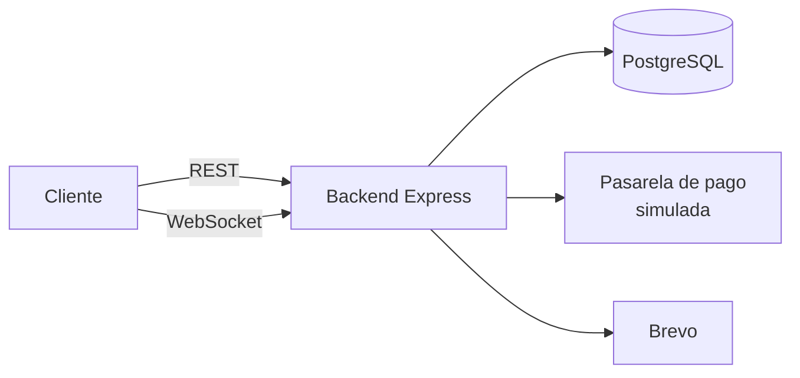

# Lifex — Sistema de Reservas de Vuelos en Tiempo Real

Prototipo de un sistema de reservas de vuelos en tiempo real para la aerolínea ficticia **Lifex**: búsqueda
de vuelos, mapa de asientos interactivo con bloqueo temporal, confirmación de compra con pago simulado y
dashboard de ocupación en vivo.

## Visión general de la arquitectura

Monolito modular en Node.js/TypeScript con arquitectura hexagonal (puertos y adaptadores): el dominio
(reglas de negocio) está aislado de la base de datos, del servidor HTTP, del WebSocket y de cualquier
proveedor externo (pago, correo) detrás de interfaces (*puertos*). Cada integración externa es un adaptador
intercambiable, verificado automáticamente por un test de arquitectura que falla si algún módulo importa la
capa equivocada.



El detalle completo — diagrama extendido, justificación de cada decisión, manejo de concurrencia e
idempotencia, y el diagrama de cómo se vería esto en producción a escala de miles de usuarios — está en
[`docs/architecture.md`](docs/architecture.md).

Los criterios de aceptación de cada historia de usuario están en
[`docs/user-stories-acceptance-criteria.md`](docs/user-stories-acceptance-criteria.md); el desglose de
tareas de implementación, en [`docs/tasks.md`](docs/tasks.md); el plan de datos de prueba (seed), en
[`docs/seed-plan.md`](docs/seed-plan.md); y el uso de IA durante el desarrollo, en [`docs/ia.md`](docs/ia.md).

## Estructura del repositorio

```
lifex/
├── backend/              # API — Express, arquitectura hexagonal por módulos
├── frontend/             # React — web pública + dashboard admin
├── shared/               # Esquemas Zod de DTOs y catálogo de eventos de WebSocket
├── docs/
│   ├── architecture.md
│   ├── user-stories-acceptance-criteria.md
│   ├── tasks.md
│   ├── seed-plan.md
│   └── ia.md
└── README.md
```

## Ejecución local

> Instrucciones a confirmar/ajustar una vez el código esté implementado; reflejan los scripts ya existentes
> en el scaffold base del backend.

### Requisitos
- Node.js (versión del `.nvmrc`/`engines` del backend)
- Docker (para PostgreSQL vía Testcontainers en las pruebas de integración, o para levantar Postgres local)
- Una cuenta de Brevo con API key (opcional — sin ella, el envío de correo queda en modo log)

### Backend

```bash
cd backend
cp .env.example .env        # completar DATABASE_URL, JWT_ACCESS_SECRET, MAX_SEAT_LOCK_TIME, IATA_TRM, etc.
npm install
npm run db:migrate
npm run db:generate
npm run db:seed             # ver docs/seed-plan.md
npm run admin:create        # usuario SUPER_ADMIN inicial, si hace falta
npm run dev
```

### Frontend

```bash
cd frontend
npm install
npm run dev
```

### Pruebas

```bash
cd backend
npm run test:unit
npm run test:acceptance
npm run test:integration    # requiere Docker
npm run verify              # lint + formato + tipos + todas las pruebas + test de arquitectura
```

## Variables de entorno relevantes del dominio

| Variable | Descripción | Default |
|---|---|---|
| `MAX_SEAT_LOCK_TIME` | Minutos que dura el bloqueo temporal de un asiento | `15` |
| `IATA_TRM` | Tasa de cambio USD→COP para mostrar precios en español | `3300` |
| `BREVO_API_KEY` | API key para el envío del ticket por correo | — |

Las demás variables (conexión a base de datos, secretos de JWT, duración de tokens, CORS) siguen la
convención ya existente del backend; ver `backend/.env.example`.
# lifex
