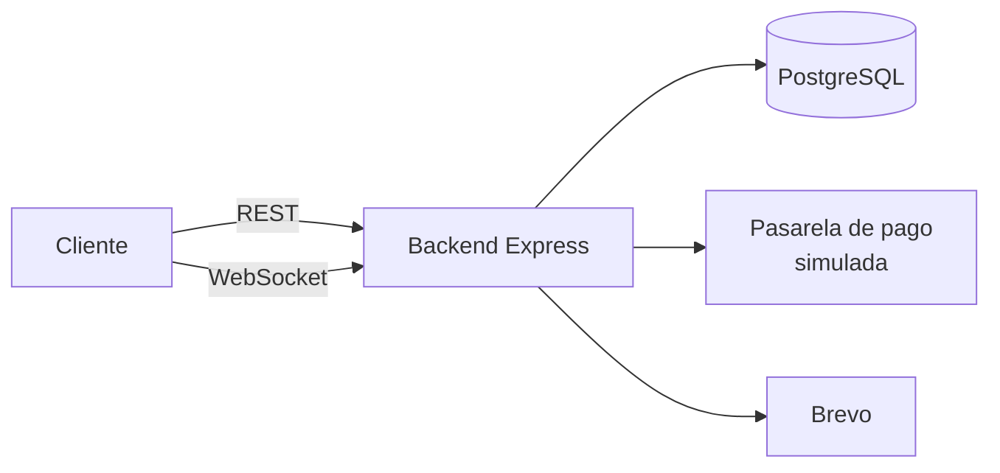

# Lifex — Sistema de Reservas de Vuelos en Tiempo Real

Prototipo de un sistema de reservas de vuelos en tiempo real para la aerolínea ficticia **Lifex**: búsqueda
de vuelos, mapa de asientos interactivo con bloqueo temporal, confirmación de compra con pago simulado y
dashboard de ocupación en vivo.

## Visión general de la arquitectura

Monolito modular en Node.js/TypeScript con arquitectura hexagonal (puertos y adaptadores): el dominio
(reglas de negocio) está aislado de la base de datos, del servidor HTTP, del WebSocket y de cualquier
proveedor externo (pago, correo) detrás de interfaces (*puertos*). Cada integración externa es un adaptador
intercambiable, verificado automáticamente por un test de arquitectura que falla si algún módulo importa la
capa equivocada.



El detalle completo — diagrama extendido, justificación de cada decisión, manejo de concurrencia e
idempotencia, y el diagrama de cómo se vería esto en producción a escala de miles de usuarios — está en
[`docs/architecture.md`](docs/architecture.md).

Los criterios de aceptación de cada historia de usuario están en
[`docs/user-stories-acceptance-criteria.md`](docs/user-stories-acceptance-criteria.md); el desglose de
tareas de implementación, en [`docs/tasks.md`](docs/tasks.md); el plan de datos de prueba (seed), en
[`docs/seed-plan.md`](docs/seed-plan.md); y el uso de IA durante el desarrollo, en [`docs/ia.md`](docs/ia.md).

## Estructura del repositorio

```
lifex/
├── backend/              # API — Express, arquitectura hexagonal por módulos
│   └── src/shared/notifications/templates/   # plantillas de correo (HTML + texto plano)
├── frontend/
│   ├── web/              # Vite + React — web pública (se publica en "/")
│   ├── dashboard/        # Vite + React + shadcn — login y panel administrativo (se publica en "/dashboard")
│   ├── public/           # activos compartidos: fuentes, fotos de destinos, logos y PNG de correo
│   ├── scripts/          # assemble.mjs: junta los dos builds en frontend/dist
│   └── server.mjs        # servidor estático de producción (web en "/", dashboard en "/dashboard")
├── shared/               # @lifex/shared — esquemas Zod de DTOs y catálogo de eventos de WebSocket
├── docs/
│   ├── architecture.md
│   ├── user-stories-acceptance-criteria.md
│   ├── tasks.md
│   ├── seed-plan.md
│   └── ia.md
└── README.md
```

## Ejecución local

> El backend está implementado y probado; el frontend está pendiente.

### Requisitos
- Node.js (versión del `.nvmrc`/`engines` del backend)
- Docker (para PostgreSQL vía Testcontainers en las pruebas de integración, o para levantar Postgres local)
- Una cuenta de Brevo con API key (opcional — sin ella, el envío de correo queda en modo log)

### Shared

```bash
cd shared
npm install      # el backend lo usa en sus pruebas de contrato (y el frontend, con un alias)
npm run typecheck
```

### Backend

```bash
cd backend
cp .env.example .env        # completar JWT_ACCESS_SECRET (≥ 32 caracteres) y, opcional, BREVO_API_KEY
docker compose up -d --wait postgres   # PostgreSQL en 127.0.0.1:55432, base "lifex"
npm install
npm run db:migrate
npm run db:generate
npm run db:seed             # catálogo, roles, usuarios y vuelos; ver docs/seed-plan.md
npm run admin:create        # usuario SUPER_ADMIN inicial, si hace falta
npm run dev                 # API en http://localhost:3000 y WebSocket en ws://localhost:3000/ws
```

Usuarios del seed: `admin@lifex.test` y `viewer@lifex.test`, contraseña `Lifex-Demo-2026!`.
Tarjetas de prueba: `4242 4242 4242 4242` (aprobada), `4000 0000 0000 0002` (rechazada),
`4000 0000 0000 9995` (timeout de la pasarela).

### Frontend

Son dos proyectos Vite independientes; las fotos, fuentes y logos viven en `frontend/public/` y los usan los dos.

```bash
cd frontend
npm run install:all     # instala web, dashboard y la raíz
npm run dev:web         # http://localhost:5173        (web pública)
npm run dev:dashboard   # http://localhost:5174/dashboard/  (login + panel)
```

Variables de cada proyecto en su `.env.example` (`VITE_API_URL`; la web usa `VITE_DASHBOARD_URL` para el enlace de
"Iniciar sesión" y el dashboard usa `VITE_WEB_URL` para "Ver sitio"). El backend debe permitir ambos orígenes en
`CORS_ORIGINS` (`http://localhost:5173,http://localhost:5174`).

Para desplegar ambas URL con un solo servicio:

```bash
cd frontend
npm run build           # web/dist + dashboard/dist → frontend/dist (web en "/", dashboard en "/dashboard")
npm start               # node server.mjs (usa PORT)
```

### Pruebas

```bash
cd backend
npm run test:unit
npm run test:acceptance
npm run test:integration    # requiere Docker
npm run verify              # lint + formato + tipos + todas las pruebas + test de arquitectura
```

## Variables de entorno relevantes del dominio

| Variable | Descripción | Default |
|---|---|---|
| `MAX_SEAT_LOCK_TIME` | Minutos que dura el bloqueo temporal de un asiento | `15` |
| `IATA_TRM` | Tasa de cambio USD→COP para mostrar precios en español | `3300` |
| `MAX_HELD_SEATS_PER_SESSION` | Asientos que una sesión puede mantener bloqueados a la vez | `6` |
| `BOOKING_TOKEN_EXPIRATION_TIME` | Vigencia de la reserva en curso (token de invitado) | `45m` |
| `TAX_PERCENTAGE` | Impuestos sobre el precio del vuelo | `19` |
| `OUTBOX_MAX_ATTEMPTS` | Reintentos de un evento del outbox (pago, correo) antes de darlo por fallido | `5` |
| `BREVO_API_KEY` | API key de Brevo para los correos (boleto y aviso de vuelo). Sin ella solo se registra en el log | — |
| `BREVO_SENDER_EMAIL` / `BREVO_SENDER_NAME` | Remitente de los correos (debe estar verificado en Brevo) | `no-reply@lifex.test` / `Lifex` |
| `BUSINESS_BASE_MULTIPLIER` | Business parte de `basePriceDefault ×` este valor (precio dinámico, HU5) | `3` |
| `OFFER_DISCOUNT_PERCENTAGE` | Descuento fijo (%) de las ofertas de la portada; una oferta no lleva precio dinámico | `15` |
| `APP_URL` | URL pública del frontend; los correos cargan el logo desde `${APP_URL}/mail/…` | `http://localhost:5173` |
| `PUBLIC_API_URL` | URL pública de la API; los correos enlazan allí la imagen QR del ticket | `http://localhost:3000` |

Otras piezas: los correos (confirmación de boleto, un correo por ticket, y aviso de vuelo cancelado o
retrasado, un correo por orden) se detallan en [`docs/architecture.md`](docs/architecture.md) §4.4.1–4.4.2.

Las demás variables (conexión a base de datos, secretos de JWT, duración de tokens, CORS) siguen la
convención ya existente del backend; ver `backend/.env.example`.
# lifex
