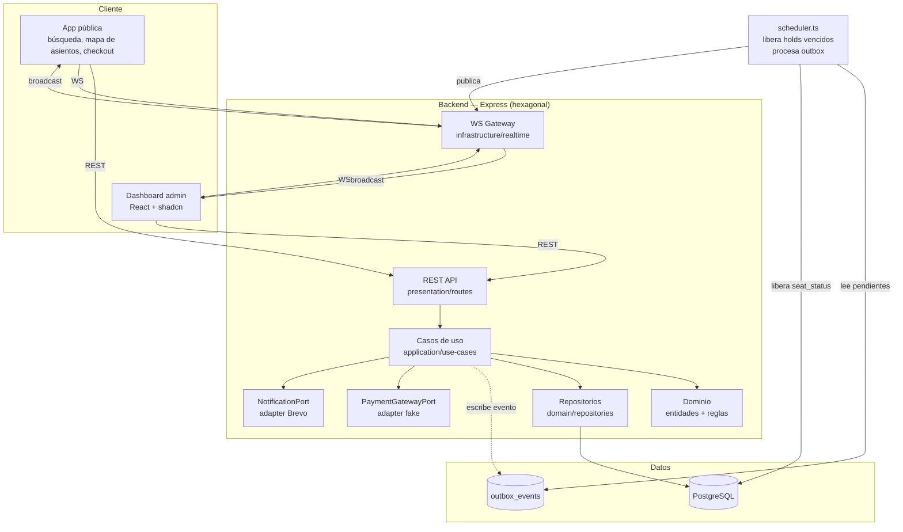
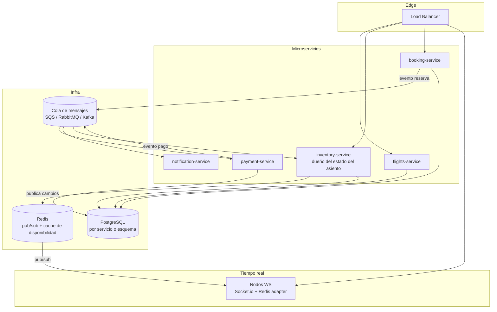

# Arquitectura — Lifex (Sistema de Reservas de Vuelos en Tiempo Real)

## 1. Resumen

Monolito modular en Node.js + TypeScript, sobre arquitectura hexagonal (puertos y adaptadores), extendiendo
el scaffold propio ya existente (auth, roles dinámicos, permisos). Backend con Express + Prisma + PostgreSQL;
tiempo real con `ws` (WebSocket nativo); sin Redis ni colas externas — la consistencia y la entrega de
eventos se resuelven con PostgreSQL (transacciones + patrón Outbox) y el `scheduler.ts` ya existente en el
proyecto.

## 2. Diagrama de arquitectura (estado actual, para la prueba)



## 3. Justificación de la arquitectura

Hexagonal (puertos y adaptadores), como monolito modular, con cada módulo de negocio organizado en
`domain/`, `application/`, `infrastructure/` y `presentation/` (regla ya impuesta por el test de arquitectura
del scaffold base).

- **Varios adaptadores de entrada y de salida.** El sistema recibe peticiones por REST y mantiene conexiones
  WebSocket; hacia afuera llama a una pasarela de pago simulada y a Brevo para el correo. Hexagonal está
  pensada justo para este caso: cada integración externa es un adaptador intercambiable, nunca una
  dependencia del dominio.
- **Aislamiento real, no solo de intención.** La arquitectura aísla el dominio de cualquier proveedor externo
  detrás de un puerto definido en `application/ports/`. La pasarela de pago, Brevo y la difusión de eventos
  por WebSocket son, los tres, adaptadores en `infrastructure/`, nunca dependencias directas de los casos de
  uso. Las reglas R2 (`application/**` nunca importa `infrastructure/**`) y R4 (`infrastructure/**` nunca
  importa `presentation/**`), verificadas por un test automático y no solo por disciplina del equipo,
  garantizan que cambiar el gateway de pago por uno real, o Brevo por otro proveedor de correo, implica
  escribir un adaptador nuevo sin tocar una sola línea del dominio ni de los casos de uso.
- **Testeable sin infraestructura.** Cada caso de uso se prueba con un repositorio en memoria; las pruebas de
  aceptación montan la aplicación completa sin Postgres real.
- **Costo asumido conscientemente.** Hexagonal exige más interfaces que un MVC en capas simple. Para un
  monolito de una sola aerolínea, ese costo es bajo comparado con el valor de aislar el pago y el tiempo real
  — las dos piezas más propensas a cambiar de proveedor o de protocolo.
- **Por qué no Clean Architecture a secas ni DDD modular completo:** el dominio aquí no tiene tantas reglas de
  negocio cruzadas entre sí como para justificar organizar por *bounded contexts* (DDD) ni la capa adicional
  de casos de uso explícitos por "acción de negocio" que exige Clean. Hexagonal ya resuelve el problema real
  (aislar proveedores externos) con menos piezas.

## 4. Manejo de concurrencia y estado en tiempo real

### 4.1 Estado de un asiento

`FREE → BLOCKED → PAYMENT_PENDING → RESERVED`, con retorno a `FREE` si el bloqueo expira o el pago es
rechazado.

- `BLOCKED`: el cliente seleccionó el asiento, tiene `held_by_session` y `hold_expires_at` (ahora + los
  minutos de `MAX_SEAT_LOCK_TIME`, 15 por defecto, en `.env`).
- `PAYMENT_PENDING`: se inició el pago. Este estado existe para que el job de expiración de bloqueos nunca
  libere un asiento que está siendo pagado en ese instante — es la corrección más importante frente a un
  diseño ingenuo de "bloqueo con TTL" únicamente.
- `RESERVED`: pago aprobado, ticket emitido. Estado final, no vuelve atrás.

### 4.2 Bloqueo atómico (sin doble reserva)

```sql
UPDATE flights_seat_availability
SET seat_status = 'BLOCKED', held_by_session = $session, hold_expires_at = now() + interval '15 minutes'
WHERE id = $seatId
  AND (seat_status = 'FREE' OR (seat_status = 'BLOCKED' AND hold_expires_at < now()))
RETURNING *;
-- 0 filas devueltas → 409 Conflict: el asiento ya no está disponible
```

La base de datos es la única fuente de verdad del bloqueo — no hay lock en memoria ni en Redis. La
restricción única `(scheduled_flight_id, seat_identifier)` en la tabla de asientos es la última línea de
defensa: aunque hubiera un error en la lógica de arriba, Postgres impide vender dos veces el mismo asiento.

### 4.3 Expiración del bloqueo

Doble mecanismo:
1. **Expiración perezosa**: la condición del UPDATE de arriba ya trata como libre un `BLOCKED` vencido, sin
   esperar a ningún job.
2. **Job periódico en `scheduler.ts`** (cada 30 segundos, igual que el job existente de purgar refresh
   tokens): libera asientos con `hold_expires_at < now()` que sigan en `BLOCKED`, escribe un evento
   `SeatReleased` en el outbox y el propio job lo publica por WebSocket.

### 4.4 Idempotencia y "nunca perder una compra"

Patrón **Outbox** sobre la misma base de datos, sin cola externa:

1. El cliente envía `POST /bookings/:id/payments` con header `Idempotency-Key` (UUID generado al entrar al
   checkout).
2. Se busca la clave en `orders.idempotency_key` (columna única). Si ya existe con el mismo cuerpo, se
   devuelve la respuesta ya guardada; si existe con otro cuerpo, `422`.
3. **Transacción 1** (atómica): el asiento pasa a `PAYMENT_PENDING`, el pago se crea en `PENDING`, y se
   inserta una fila en `outbox_events` (`PaymentRequested`) — todo en la misma transacción que la reserva, o
   se guardan los tres o ninguno. Se responde `202 Accepted`; el cliente espera el resultado por WebSocket.
4. El worker del outbox (`scheduler.ts`, cada 300 ms) lee eventos `PENDING` y entrega cada uno a su
   manejador. Para `PaymentRequested` llama al `PaymentGatewayPort` (con `payment.id` como clave de
   idempotencia hacia la pasarela) y marca el evento `PROCESSED`; si falla lo reintenta con *backoff*
   exponencial (`OUTBOX_MAX_ATTEMPTS`, 5 por defecto) y, agotados los reintentos, rechaza el pago y libera
   los asientos para que nunca queden en `PAYMENT_PENDING` para siempre.
5. **Transacción 2**, según el resultado:
   - **Aprobado**: pago → `APPROVED`, orden → `CONFIRMED`, asiento → `RESERVED` (UPDATE condicional
     `WHERE seat_status = 'PAYMENT_PENDING'`), se genera el ticket (restricción única
     `(scheduled_flight_id, seat_id)` en `tickets` vía la FK a `flights_seat_availability`), y se escriben los
     eventos `BookingConfirmed` + `SeatSold` en el outbox.
   - **Rechazado**: pago → `REJECTED`, asiento vuelve a `FREE`, evento `SeatReleased`.
6. La transacción 2 escribe también un evento `TicketEmailRequested` **por cada ticket**. El worker lo
   entrega al `NotificationPort` (adapter Brevo) y hace el broadcast por WebSocket de `SeatSold` y
   `BookingConfirmed` a los clientes del vuelo. Cada correo se reintenta de forma independiente: un fallo
   del proveedor nunca revierte la reserva ya confirmada ni reenvía los correos que sí salieron.

La tarjeta no viaja por el outbox: antes de la transacción 1 el gateway la valida (Luhn, vencimiento,
CVV) y la convierte en un *token*; solo el token (y marca + últimos 4 dígitos) se persiste.
Para detectar la misma `Idempotency-Key` con otro cuerpo se guarda una huella HMAC del cuerpo
(`orders.idempotencyHash`), nunca un hash a pelo del número de tarjeta.

No se guarda nunca el número completo de la tarjeta de prueba: solo marca, últimos 4 dígitos y la referencia
que devuelve el adapter fake.

### 4.4.1 Notificaciones por correo

`NotificationPort` (en `tickets/application/ports/`) tiene dos operaciones: confirmación de boleto
(un correo por ticket) y aviso de vuelo cancelado o retrasado (un correo por orden). Lo implementan
`BrevoNotificationAdapter` y, cuando no hay `BREVO_API_KEY`, `LogNotificationAdapter` (solo registra el
intento y no rompe el flujo).

- **Plantillas** en `backend/src/shared/notifications/templates/` (HTML + texto plano):
  `ticket-confirmation` y `flight-status-change`. Viven en `shared/` porque varios módulos pueden
  notificar; no son de dominio y no violan R5. Se renderizan en el backend con `renderEmail()`
  (variables `{{ params.NOMBRE }}`; el HTML escapa los valores y una variable sin valor es un error, no
  un "undefined" enviado al cliente) y se envían como `htmlContent` + `textContent`, sin depender de
  plantillas guardadas en Brevo.
- **Parámetros**: el adapter los arma en `email-params.ts` (fecha y hora en `America/Bogota`, clase del
  asiento traducida, total en COP con `IATA_TRM` si el comprador navegó en español, o en USD). El idioma
  se guarda en `orders.locale` al iniciar la reserva (`Accept-Language`).
- **QR**: `GET /tickets/:code/qr.png` (público, solo existe para tickets reales, cacheable) genera la
  imagen con la librería `qrcode` detrás del puerto `QrCodeGenerator`. Los correos enlazan
  `PUBLIC_API_URL/tickets/<code>/qr.png`, porque Gmail y otros clientes bloquean imágenes `data:`.
- **Decisión: un correo por ticket** (no uno por orden). Cada boleto lleva su propio QR y se reintenta
  de forma aislada. Los correos van al `contact_email` de la orden, que puede diferir del de los
  pasajeros.

### 4.4.2 Aviso de vuelo cancelado o retrasado

Cuando un administrador pasa un vuelo a `CANCELLED` o `DELAYED`, `PrismaScheduledFlightRepository.updateStatus`
escribe, **en la misma transacción** del cambio de estado, el evento `FlightStatusChanged` (para el
tiempo real) y un evento interno `FlightDisruptionEmailRequested` por cada orden `CONFIRMED` de ese
vuelo. El caso de uso `SendFlightDisruptionEmail` (módulo `tickets`) lo consume y envía un solo correo
por orden con todos sus pasajeros. Reglas: no se notifica a órdenes sin pagar ni de otros vuelos; volver
a `ACTIVE` o `FINALIZED` no envía nada; un fallo del proveedor se reintenta con *backoff* y el cambio de
estado ya guardado no se revierte.

### 4.4.3 Precios dinámicos y ofertas

El precio de cada clase se calcula al mostrar el vuelo, con un servicio de dominio puro
(`flights/domain/services/dynamic-price.ts`): primer ticket +20 %, promedio +5 % y +0,5 % por hora en las
últimas 72 h (congelado a 2 h nacional / 5 h internacional). Una oferta (vuelo `ACTIVE` a 8–30 días con
ocupación ≤ 60 %, ≥ 100 asientos libres o promedios dentro de 30 % de su base) sustituye ese cálculo por el
precio base menos `OFFER_DISCOUNT_PERCENTAGE`. Las reglas completas están en HU5
([`user-stories-acceptance-criteria.md`](user-stories-acceptance-criteria.md)).

- `GET /flights`, `GET /flights/:id` y `GET /flights/offers` (público; hasta 5 nacionales y 5 internacionales,
  sin repetir ruta) devuelven `priceEconomyUsd`, `priceBusinessUsd` y `offer`. `/flights/offers` se registra
  antes que `/flights/:id`.
- `HoldSeat` guarda el precio vigente en `flights_seat_availability.seat_price`: el precio se congela al
  bloquear y es el que cobran la reserva y el pago.
- `settleApproved` recalcula, en la misma transacción que confirma el pago, `num_available_seats`,
  `occupancy_rate`, `average_price_economy` y `average_price_business` a partir de los asientos `RESERVED`.
- Variables de entorno (solo se leen en `composition.ts`): `BUSINESS_BASE_MULTIPLIER` (3) y
  `OFFER_DISCOUNT_PERCENTAGE` (15).

### 4.5 Tiempo real: por qué `ws` y no Socket.io

Se eligió la librería `ws` (WebSocket nativo) en vez de Socket.io para no introducir una dependencia con
funcionalidad que aquí no se usa (salas automáticas, reconexión con *fallback* a polling) y mantener
consistencia con el resto del stack, que ya no usa ninguna librería de infraestructura "pesada" (ni Redis, ni
colas externas).

- **Autenticación en el *upgrade***: el JWT viaja como query param (`?token=...`) o en el primer mensaje tras
  conectar, y se valida con el mismo `AccessTokenService` que ya usa el REST.
- **Temas (equivalente a "rooms")**: un registro manual `Map<topic, Set<WebSocket>>` en
  `infrastructure/realtime/ws-broadcaster.ts`. Temas usados: `flight:{id}` (mapa de asientos),
  `flights:search` (cambios de estado de vuelo), `dashboard:{id}` (métricas de ocupación).
  `RealtimeBroadcaster` es el puerto en `application/ports/`; el dominio y los casos de uso nunca importan
  `ws` directamente (regla R4 del test de arquitectura).
- **Protocolo**: el cliente envía `{"action":"subscribe","topic":"flight:<id>"}` (o `unsubscribe`);
  el servidor responde `subscribed` / `error` y luego difunde los eventos del tema. Los temas
  `dashboard:*` exigen el permiso `dashboard:read` (token del staff); los demás son públicos.
  Las rutas públicas viven en `/ws`.
- **Heartbeat**: *ping/pong* cada 30s para limpiar conexiones muertas del registro de temas.
- **Snapshot + versión, no solo el socket.** Cada evento lleva un `version` secuencial por vuelo. Al conectar
  o al detectar un salto en la secuencia, el cliente pide el snapshot actual por REST y luego aplica los
  eventos nuevos. Esto es lo que de verdad garantiza que "siempre se reflejen los cambios" — el socket por sí
  solo nunca lo garantiza (una desconexión de 2 segundos puede perder un evento).
- **Límite reconocido**: `ws` sin adaptador multi-instancia no escala horizontalmente por sí solo (a
  diferencia de Socket.io + Redis adapter). Para esta prueba, con una sola instancia, no es un problema; se
  trata en el diagrama de producción (sección 6).

## 5. Decisiones técnicas clave

| Decisión | Alternativa descartada | Motivo |
|---|---|---|
| `ws` nativo | Socket.io | Ya no se necesita ninguna de sus funciones extra; menos dependencias. |
| Outbox + `scheduler.ts` | pg-boss / BullMQ + Redis | Cero infraestructura nueva; reutiliza un mecanismo que ya existe y ya se prueba en el scaffold. |
| Prisma como ORM | Drizzle | Ya es el ORM del scaffold base; consistencia de convención. |
| Catálogo (`countries`, `cities`, `airports`) normalizado | Strings sueltos en `flight_routes` | Reusable, y resuelve el requisito de nombres en inglés/español sin duplicar filas. |
| Roles dinámicos (`ADMIN`, `ADMIN_VIEWER`) sobre el sistema de permisos existente | Enum fijo `role` en `users` | Reutiliza el sistema de autorización ya construido y probado. |
| Correo renderizado en el backend (plantilla local + `htmlContent`) | Plantillas guardadas en Brevo | La plantilla se versiona y se prueba con el código; cambiar de proveedor no obliga a migrarlas. |
| Imagen QR servida por la propia API | `data:` URI o servicio externo de QR | Gmail bloquea `data:`; un servicio externo vería los códigos de ticket. |
| Precio siempre en USD, conversión a COP solo en el front con `IATA_TRM` | Guardar dos columnas de precio | Evita desincronización si el TRM cambia. |

## 6. Diagrama alterno — versión de producción

Para miles de usuarios concurrentes, los mismos límites reconocidos arriba (una sola instancia, sin cola
externa) dejarían de ser aceptables. Versión pensada para ese escenario:



Cambios frente a la versión de la prueba: `inventory` (asientos) se separa como servicio dueño del estado del
asiento para que la escritura del bloqueo escale de forma independiente; la cola de mensajes reemplaza al
Outbox+scheduler cuando el volumen de eventos supera lo que un job periódico puede procesar a tiempo; Redis
pub/sub permite que cualquier nodo WebSocket reciba un evento sin importar en qué nodo esté conectado cada
cliente, resolviendo el límite de `ws` sin adaptador mencionado en 4.5.

## 7. Modelo de base de datos (final)

> **Convenciones reales de la implementación** (difieren de los nombres en `snake_case` de los bloques de
> abajo, que se conservan como referencia de diseño): las columnas siguen la convención de Prisma en
> `camelCase` (`seatStatus`, `holdExpiresAt`) con el nombre de tabla en `snake_case` (`@@map`); las tablas
> nuevas usan `UUID` como clave primaria (`gen_random_uuid()`) y las de catálogo `Int`. Campos añadidos
> durante la implementación:
> `scheduled_flights.eventVersion` (versión secuencial de eventos por vuelo),
> `orders.locale` / `orders.idempotencyHash`, `passengers.seatId` / `luggageTypeId` / `position` (el
> primero es el comprador), `aircraft.businessSeats` / `seatColumns`, `luggage_type.businessOnly`,
> `outbox_events.nextAttemptAt` / `lastError`, `flights_seat_availability.version`.

### 7.1 Identidad y autorización (ya existente en el scaffold, sin cambios de esquema)
`users`, `roles`, `role_permissions`, `user_roles`, `refresh_tokens`, `password_resets`. Solo para staff
(`ADMIN`, `ADMIN_VIEWER`, más `SUPER_ADMIN` del sistema). El cliente invitado nunca crea una fila en `users`.

### 7.2 Catálogo

```
countries        id, iso_code, name, name_es
cities           id, country_id → countries, name, name_es
airports         id, city_id → cities, iata_code
aircraft         id, internal_identifier, reference (modelo), description, description_es,
                 type_range (DOMESTIC|INTERNATIONAL), range_miles (millas náuticas),
                 max_number_seats, business_seats, seat_columns, status (AVAILABLE|UNAVAILABLE)
luggage_type     id, name, name_es, rank, fee_percentage   -- catálogo único, sin cruzar con flight_class
```

### 7.3 Vuelos e inventario

```
flight_routes             id, route_type (DOMESTIC|INTERNATIONAL),
                          from_airport_id → airports, destination_airport_id → airports

scheduled_flights         id, flight_route_id → flight_routes, aircraft_id → aircraft,
                          departure_date, arrival_date, num_max_seats, num_available_seats,
                          occupancy_rate, base_price_default, average_price_economy,
                          average_price_business,
                          status (ACTIVE|CANCELLED|DELAYED|SOLD_OUT|FINALIZED),
                          created_at, updated_at

flights_seat_availability id, scheduled_flight_id → scheduled_flights,
                          seat_identifier (único por vuelo, ej. "08A"), seat_row, seat_column,
                          seat_class (ECONOMY|BUSINESS), seat_price,
                          seat_status (FREE|BLOCKED|PAYMENT_PENDING|RESERVED),
                          held_by_session, hold_expires_at, version
                          UNIQUE (scheduled_flight_id, seat_identifier)
```

### 7.4 Reservas, pasajeros, tickets y pago

```
orders              id, order_number, reservation_number, scheduled_flight_id → scheduled_flights,
                    contact_email, contact_phone,
                    status (DRAFT|PAYMENT_PENDING|CONFIRMED|CANCELLED|EXPIRED),
                    flight_price, taxes, total_price, idempotency_key (único), expires_at,
                    created_at, updated_at

passengers          id, order_id → orders, full_name, last_name, document_type, document_number,
                    gender (MASCULINO|FEMENINO), date_birth, nationality_country_id → countries,
                    passenger_type (ADULT|CHILD)

tickets              id, passenger_id → passengers, seat_id → flights_seat_availability,
                    ticket_code, check_in_available, check_in, check_in_date, created_at
                    UNIQUE (seat_id)

ticket_luggage       id, ticket_id → tickets, luggage_type_id → luggage_type, fee_applied_percentage

payments             id, order_id → orders, amount, status (PENDING|APPROVED|REJECTED),
                    card_brand, card_last4, gateway_reference, idempotency_key (único),
                    created_at, updated_at

outbox_events        id, aggregate_type, aggregate_id, event_type, payload (jsonb),
                    status (PENDING|PROCESSED|FAILED), attempts, created_at, processed_at
```

El pasajero comprador no duplica datos: es, simplemente, el primer `passenger` de la orden. Los datos de
contacto de la orden (`contact_email`/`contact_phone`) pueden diferir de los de cualquier pasajero (p. ej.
alguien compra para su familia y pone su propio correo para las notificaciones).

## 8. Internacionalización

Los nombres mostrados al usuario (`countries.name`/`name_es`, `cities.name`/`name_es`, `luggage_type.name`/
`name_es`) llevan el inglés en la columna original (sin renombrar) y el español en la columna `_es`. Los
valores de enum (`DOMESTIC`, `ACTIVE`, `ECONOMY`, etc.) no se traducen en base de datos — el front los mapea a
texto legible según el idioma activo, igual que ya hace el scaffold con los mensajes de error
(`shared/i18n/messages.ts`).

Los precios se guardan siempre en USD. Al cambiar el idioma a español, el front convierte a COP multiplicando
por `IATA_TRM` (variable de entorno) solo en el momento de mostrar el dato — nunca se persiste un segundo
precio.
